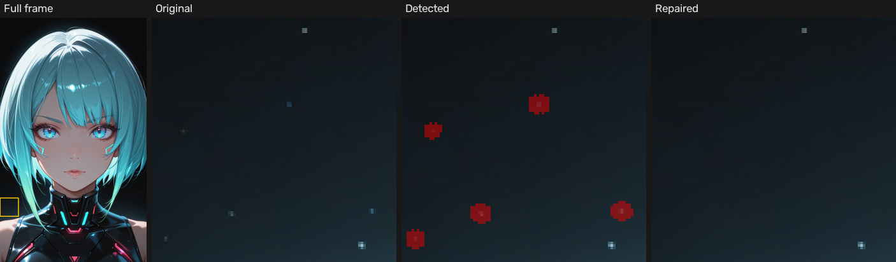

# ComfyUI-VAE-Noise-Fix

[](https://github.com/megrez33281/ComfyUI-VAE-Noise-Fix/actions/workflows/ci.yml)
[](LICENSE)

**English** | [繁體中文](README.zh-TW.md)

A lightweight ComfyUI custom node that **detects and repairs isolated bright pixels left by the SDXL VAE** ("fireflies"), using classical computer vision: Laplacian + median residual → connected-component shape filtering → CIE-LAB cliff check → Telea inpainting.
**No neural network, no model download, runs on CPU in milliseconds to about a second.**



<sub>Crop from `dataset/GroupA/000.png` at 4× nearest-neighbour zoom, default settings. Regenerate with `python scripts/make_readme_figure.py`.</sub>

---

## Why this exists

The SDXL VAE decodes a 4-channel latent at 8× spatial compression. With high CFG it often leaves isolated pure-white or pure-colour pixels on dark backgrounds and high-contrast edges, usually called *spurious bright pixels* or *isolated high-frequency artifacts*.

The usual fixes (Hires. fix, U-Net inpainting) re-run a neural network. That costs VRAM and can change details you were already happy with. This node goes the other way: classical CV finds the few bad pixels and patches only those, without touching the GPU.

## Features

- **Five-stage detection**: dual-path energy (Laplacian + median residual) → dual threshold (seed / context) → structural filter (area, shape, isolation) → LAB cliff and chroma check → morphological dilation
- **Resolution-aware**: `max_noise_size` is defined at 1024² and scales automatically with image area
- **Highlight-aware**: soft highlights with a gradual falloff and elongated structures (hair, thin lines) are filtered out rather than painted over
- **Zero NN dependency**: only OpenCV and NumPy
- **Batch support**: handles ComfyUI `[B, H, W, C]` tensors, so it works on video and frame sequences
- **11 preview modes**: inspect any intermediate map (Laplacian, median, seed, context, filtered, verified) directly in ComfyUI while tuning
- **MASK output**: reuse the detection mask in any downstream node
- **Manual touch-up**: split Detector / Mask Editor / Inpainter nodes with a built-in popup mask editor
- **Standalone GUI**: tune parameters on your own images without ComfyUI (tkinter, no PyTorch needed)

---

## Installation

### ComfyUI-Manager (recommended)

Open **Manager → Custom Nodes Manager**, search for **VAE Noise Fix**, click *Install*, and restart ComfyUI.

### comfy-cli

```bash
comfy node install vae-noise-fix
```

### Manual

```bash
cd ComfyUI/custom_nodes/
git clone https://github.com/megrez33281/ComfyUI-VAE-Noise-Fix.git
pip install -r ComfyUI-VAE-Noise-Fix/requirements.txt   # opencv-python, numpy
```

Use the same Python environment that runs ComfyUI (for the portable build: `python_embeded\python.exe -m pip install -r ...`). PyTorch and Pillow ship with ComfyUI.

After restarting, the nodes appear under **Add Node → image → postprocessing**.

---

## Nodes

| Node | Outputs | Use it when |
|------|---------|-------------|
| **VAE Noise Fix (Traditional CV)** | `image`, `mask` | You want detection and repair in one step |
| **VAE Noise Detector** | `image`, `mask` | You want to inspect or edit the mask before repairing |
| **VAE Noise Mask Editor** | `image`, `mask` | You want to paint/erase mask regions by hand (popup editor) |
| **VAE Noise Inpainter (Telea)** | `image` | You already have a mask (from the Detector, the editor, or any other node) |

### Parameters

| Parameter | Type | Default | Description |
|-----------|------|---------|-------------|
| `image` | IMAGE | — | Input batch `[B, H, W, C]` |
| `gradient_sensitivity` | FLOAT 0.01–1.0 | 0.35 | Shared threshold for the Laplacian and median paths. Higher = only pixels that differ more strongly from their surroundings are flagged |
| `max_noise_size` | INT 1–100 | 6 | Largest blob (in pixels at 1024²) that counts as noise. Larger blobs are treated as real content. Scales with resolution |
| `mask_dilate` | INT 0–10 | 2 | Grow the final mask by this many pixels so inpainting samples clean pixels. In the GUI, just make sure the red mask covers the halo |
| `preview_mode` | enum | `Repaired` | Which view the `image` output shows (see below). The `mask` output is unaffected |

The Inpainter only takes `image`, `mask` and `max_noise_size`; the last one sets the Telea radius (⌈√size⌉, clamped to 2–7), so match the Detector's value.

### Preview modes

| Mode | What it shows | When to use |
|------|---------------|-------------|
| `Original` | Input passthrough | Compare against downstream nodes |
| `Mask Overlay` | Red semi-transparent mask over the image | **Main view while tuning** |
| `Mask Only` | White mask on black with green locator circles | Spot the smallest detections |
| `Repaired` | Repaired image | **Final output** |
| `Side-by-Side` | Original \| repaired (double width) | Before/after comparison |
| `Laplacian Energy Map (Binary)` | Sharp-edged bright/dark points | Check that sharp impulses are caught |
| `Median Residual Map (Binary)` | Flat colour blobs that differ from their neighbourhood | Check colour-blob artifacts |
| `Combined Seed Mask` | Laplacian ∪ median at your sensitivity | The high-energy candidate cores |
| `Context Mask (Low Thresh)` | Same at ¼ sensitivity | Whether the full halo extent is covered |
| `Filtered Candidates (Shape/Iso)` | After area / aspect-ratio / isolation rules | Whether the shape rules behave |
| `Final Verified Mask (LAB)` | After the LAB check, before dilation | What was dropped as a natural highlight |

The Detector node omits `Repaired` and `Side-by-Side`, since it never inpaints.

### Workflows

**Automatic**

```
[KSampler] → [VAE Decode] → [VAE Noise Fix] → [Save Image]
                                   │
                                   └─ mask ─► [any node that takes a MASK]
```

**With manual touch-up**

```
[VAE Decode] → [VAE Noise Detector] ─ image, mask ─► [VAE Noise Mask Editor] ─ image, mask ─► [VAE Noise Inpainter] → [Save Image]
```

1. Queue the prompt once. The Mask Editor stages the first frame and passes the detected mask through.
2. Click **Edit Mask** on the Mask Editor node. Paint to add, erase to remove; brush size, overlay opacity, undo/redo (Ctrl+Z / Ctrl+Shift+Z), clear, invert, zoom (Ctrl+wheel) and pan (Space+drag) are available. Click *Save & Close*.
3. Queue again. The edited mask is used for the whole batch.

`workflow.json` contains an example workflow that compares several `VAE Noise Fix` settings side by side.

### Tuning

1. Set `preview_mode` to `Mask Overlay` and check whether the red marks sit exactly on the artifacts.
2. Artifacts missed → lower `gradient_sensitivity`. Real detail flagged → raise it.
3. Artifacts larger than a few pixels → raise `max_noise_size`.
4. A faint halo left after repair → raise `mask_dilate`.
5. Switch back to `Repaired`.

---

## Standalone GUI

Tune parameters on any image without ComfyUI. Requires Python 3.10+ with tkinter, plus:

```bash
pip install -r requirements.txt Pillow      # PyTorch is not needed
python gui_preview.py                       # file dialog
python gui_preview.py path/to/image.png     # open one image
python gui_preview.py path/to/folder/       # browse a folder (A / D to switch)
```

The right-hand panel has sliders for the three parameters, the view list, brush editing, zoom tools, save buttons and live statistics (resolution, blob count, pixel count, coverage, area range, detection time).

| Key / mouse | Action |
|-------------|--------|
| `1`–`5` | Original / Mask Overlay / Mask Only / Repaired / Side-by-Side |
| `6` `7` `8` `9` `0` `-` | Laplacian / Median / Seed / Context / Filtered / Verified debug views |
| `E` | Toggle brush edit mode: left-drag paints, right-drag erases, wheel resizes the brush |
| `[` / `]` | Brush radius − / + |
| `C` | Clear brush edits |
| `Z` | Toggle the zoom lens; wheel changes its magnification |
| `Ctrl` + wheel | Zoom the canvas around the cursor |
| `R` | Reset canvas zoom |
| `S` | Save the current view next to the source image (plus the edited mask, if any) |
| *Apply Edits & Save Repaired* button | Apply brush edits, inpaint at full resolution and save |
| `A` / `D` | Previous / next image |
| `Q` / `Esc` | Quit |

---

## How it works

```
┌───────────────────────────────────────────────────────────────────┐
│  ComfyUI IMAGE Tensor  [B, H, W, 3]  float32  RGB  in [0, 1]      │
└──────────────────────────┬────────────────────────────────────────┘
                           │  iterate over batch dim B
                           ▼
            ┌───────────────────────────────┐
            │      TensorBridge             │   single GPU→CPU transfer
            │  RGB f32 → BGR u8             │
            └──────────────┬────────────────┘
                           ▼
   ╔══════════════════════════════════════════════════════════════╗
   ║  Stage 1 — DUAL-PATH ENERGY                                  ║
   ║    Laplacian on BT.709 luma   │  |src − median(src)|         ║
   ║    (sharp bright/dark points) │  (flat off-colour blobs)     ║
   ╠══════════════════════════════════════════════════════════════╣
   ║  Stage 2 — DUAL THRESHOLD                                    ║
   ║    seed    = Lap > s·255  OR  Med > 20 + s·80                ║
   ║    context = same at ¼ sensitivity (captures the halo)       ║
   ╠══════════════════════════════════════════════════════════════╣
   ║  Stage 3 — STRUCTURAL FILTER (CCA on context mask)           ║
   ║    ① context area ≤ 5·max_noise_size   (isolated)            ║
   ║    ② contains seed pixels, seed area ≤ max_noise_size        ║
   ║    ③ rotated-bbox aspect ratio ≤ 3      (not hair / lines)   ║
   ╠══════════════════════════════════════════════════════════════╣
   ║  Stage 4 — LAB VERIFICATION (per surviving blob)             ║
   ║    ratio = (peak L* − blob L*) / (peak L* − ring L*)         ║
   ║    keep if ratio > 0.6 − 0.2·s          (cliff, not a hill)  ║
   ║         or ‖Δa*b*‖ ≥ 3 + 15·s           (colour bleed)       ║
   ╠══════════════════════════════════════════════════════════════╣
   ║  Stage 5 — DILATION by mask_dilate (elliptical kernel)       ║
   ╚══════════════════════════════════════════════════════════════╝
                           │
                           ▼
            ┌───────────────────────────────┐
            │  Telea inpainting (FMM)       │   skipped if mask empty
            │  radius = clip(⌈√size⌉, 2, 7) │
            └──────────────┬────────────────┘
                           ▼
            PreviewMode dispatch (1 of 11 views) → TensorBridge
                           ▼
┌───────────────────────────────────────────────────────────────────┐
│  IMAGE  [B, H, W, 3]  float32 RGB  +  MASK  [B, H, W]  float32    │
└───────────────────────────────────────────────────────────────────┘
```

**Why two energy paths.** A brightness threshold alone misses pure-colour artifacts, which are not necessarily brighter than the background. The Laplacian responds strongly to sharp single-pixel jumps but weakly to small blobs with a flat interior. The median residual is the opposite: the median ignores a few extreme pixels, so subtracting it isolates small off-colour blobs. OR-ing the two covers both shapes.

**Why a seed and a context mask.** The strict seed mask answers "is there a real high-energy core?"; the loose context mask answers "how big is this region, halo included?". The structural filter needs both.

**Separating artifacts from natural highlights.** Stars, lamps and specular highlights are also small, bright and isolated. The main difference is the profile: a natural highlight is a hill that falls off gradually, while a VAE artifact is a cliff from peak straight to background. Stage 4 measures this in CIE-LAB, where lightness is separate from colour. It also keeps blobs whose colour differs strongly from the surrounding ring (purple/green VAE bleed) even without a lightness cliff.

```
Natural star (gradual falloff)        Spurious bright pixel (impulse)
  80 150 200 150  80                    10  10 255  10  10
 150 250 255 250 150                    10  10 255  10  10
  80 150 200 150  80                    10  10  10  10  10
→ hill: left alone                    → cliff: repaired
```

**Why Telea rather than PatchMatch.** For holes of 1–5 pixels, Telea's fast marching method propagates from the boundary along isophotes. It takes milliseconds, is deterministic, and cannot pull in unrelated texture from elsewhere in the image the way patch search can.

---

## Limitations

- Severe VAE breakdown (large grid-like noise) may need `max_noise_size` raised manually.
- At 4K and above, the CCA and LAB loops take extra CPU time (typically under 1–2 s).
- This is pixel-space post-processing; it cannot fix the VAE's latent bandwidth limit.
- Highlight protection is heuristic. Small or bright stars are mostly spared by the size and isolation rules, not by the LAB check. A sharp-edged highlight (for example a 2×2 pure-white star) looks exactly like an artifact and will be removed.
- Dark impulses on a bright background (dead black pixels) are detected by the Laplacian path but dropped by the LAB stage, which only accepts blobs brighter than their surroundings, so they are currently not repaired.

---

## Project structure

```
ComfyUI-VAE-Noise-Fix/
├── __init__.py              # ComfyUI entry: node mappings + WEB_DIRECTORY
├── comfyui_node.py          # The four ComfyUI nodes (no algorithm code)
├── mask_editor_server.py    # API routes for the Mask Editor popup
├── vae_noise_fix.py         # Backward-compatible import shim
├── gui_preview.py           # Standalone GUI entry point
├── web/js/
│   └── mask_editor.js       # Frontend: "Edit Mask" button + popup editor
├── core/                    # Algorithm (OpenCV + NumPy only)
│   ├── tensor_bridge.py     #   ComfyUI tensor ↔ OpenCV array (torch imported lazily)
│   ├── energy.py            #   Laplacian / median-residual energy
│   ├── thresholding.py      #   Dual-path binarisation
│   ├── structural_filter.py #   CCA + area + aspect ratio + isolation
│   ├── chromatic_filter.py  #   LAB cliff steepness + chroma distance
│   ├── morphology.py        #   Mask dilation
│   ├── detector.py          #   GradientNoiseDetector orchestrator
│   ├── inpainter.py         #   Telea / FMM inpainting
│   ├── overlay.py           #   Overlay / mask-only / side-by-side renderers
│   ├── statistics.py        #   Detection statistics
│   └── pipeline.py          #   NoiseFixPipeline, PreviewMode, DetectionResult
├── gui/                     # Standalone tkinter GUI
│   ├── preview_app.py       #   Main window, controls, event handling
│   ├── brush_editor.py      #   Manual paint / erase on the mask
│   ├── canvas_zoom.py       #   Canvas zoom & pan
│   ├── zoom_lens.py         #   Cursor-following magnifier
│   ├── statistics_hud.py    #   Statistics overlay
│   └── image_io.py          #   Unicode-path-safe image I/O (Windows)
├── tests/                   # pytest suite (synthetic images + one dataset sample)
├── scripts/
│   ├── run_dataset.py       #   Batch-run the node over dataset/ → test_output/
│   └── make_readme_figure.py#   Regenerate docs/images/before_after.png
├── dataset/                 # SDXL sample images, 4 scenes (not in registry package)
├── docs/images/             # README images
├── workflow.json            # Example ComfyUI workflow
├── pyproject.toml           # Comfy Registry metadata + pytest config
└── requirements.txt
```

### Sample dataset

| Group | Scene | Resolutions | Challenge |
|-------|-------|-------------|-----------|
| A | Cyberpunk portrait, pure black background | 768×1280, 2K | Many white artifacts on a dark background |
| B | Cyberpunk night street, neon | 768×1280, 1024², 2K | Busy high-frequency texture (neon, reflections, wet ground) |
| C | Milky Way over a mountain silhouette | 768×1280, 1024², 2K | Edge case: real stars everywhere |
| D | Anime-style portrait, clean dark background | 768×1280, 1024², 2K | Flat shading, few artifacts |

`prompt.txt` in each group holds the generation prompt.

---

## Development

```bash
pip install opencv-python numpy pillow pytest torch
pytest                         # unit + node tests
python scripts/run_dataset.py  # writes *_mask.png / *_fixed.png to test_output/ for visual review
```

CI runs the test suite on every push and pull request (Ubuntu, headless OpenCV, CPU-only PyTorch).

### Publishing to the Comfy Registry (maintainer)

1. Sign in at [registry.comfy.org](https://registry.comfy.org) and create a publisher. The publisher id (shown after `@` on your profile) is permanent.
2. Put that id in `pyproject.toml` → `[tool.comfy] PublisherId`.
3. On the registry, open the publisher and create an API key. Store it as the GitHub repository secret `REGISTRY_ACCESS_TOKEN` (*Settings → Secrets and variables → Actions → New repository secret*).
4. Push to `main`. `.github/workflows/publish.yml` publishes whenever `pyproject.toml` changes; it skips with a notice until steps 2–3 are done. You can also run it manually from the *Actions* tab.
5. For each release, bump `version` in `pyproject.toml`.

Files listed in `.comfyignore` (dataset, tests, scripts, docs) are kept in git but left out of the registry package.

---

## License

[MIT](LICENSE) © 2026 Phecda

## Acknowledgements

This started as the final project for the 影像編修技術與特效合成 (image editing and visual effects compositing) course at National Yang Ming Chiao Tung University. The submitted slides, report and related material are archived at tag [`term-project-spring-2026`](https://github.com/megrez33281/ComfyUI-VAE-Noise-Fix/tree/term-project-spring-2026).
